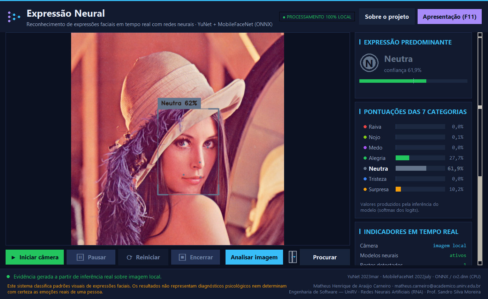

# EmotionScan

**Reconhecimento de Expressões Faciais em Tempo Real utilizando Redes Neurais**

Aplicação desktop que detecta rostos pela webcam e classifica sete expressões
faciais usando duas redes neurais convolucionais, **inteiramente offline e em
CPU**.

| | |
|---|---|
| **Acadêmico** | Matheus Henrique de Araújo Carneiro |
| **E-mail** | matheus.carneiro@academico.unirv.edu.br |
| **Curso** | Engenharia de Software — UniRV |
| **Disciplina** | Redes Neurais Artificiais (RNA) |
| **Professor** | Sandro Silva Moreira |
| **Evento** | 5º Workshop de Trabalhos de Inteligência Artificial da FASOFT — UniRV |
| **Apresentação** | 30/11/2026 |



---

## Início rápido

```bat
configurar.bat     :: 1x, com internet — ambiente + dependências + modelos
iniciar.bat        :: abre a aplicação (não precisa de internet)
verificar.bat      :: confere a prontidão antes de apresentar
testar.bat         :: executa os testes automatizados
```

Os scripts funcionam a partir de qualquer diretório do terminal — todos resolvem
o próprio caminho.

## Requisitos

- Windows 10 ou 11
- Python 3.9 a 3.12 (**testado em 3.11.9**)
- Webcam (opcional: há análise de imagem local como contingência)
- ~400 MB em disco; **não precisa de GPU**

## As sete expressões

| Rótulo | Classe do modelo |
|---|---|
| Raiva | `angry` |
| Nojo | `disgust` |
| Medo | `fearful` |
| Alegria | `happy` |
| Neutra | `neutral` |
| Tristeza | `sad` |
| Surpresa | `surprised` |

A ordem corresponde exatamente aos índices de saída da rede.

## Como funciona

```
Webcam → YuNet (detecção + 5 pontos) → alinhamento 112×112
       → MobileFaceNet (7 logits) → softmax → suavização temporal → interface
```

Duas redes neurais reais em formato ONNX, executadas pelo `cv2.dnn`:

| Modelo | Papel | Licença |
|---|---|---|
| **YuNet** `face_detection_yunet_2023mar` | detecção facial e 5 pontos de referência | Apache 2.0 |
| **MobileFaceNet / Progressive Teacher** `facial_expression_recognition_mobilefacenet_2022july` | classificação das 7 expressões | Apache 2.0 |

> **Ambos são pré-treinados por terceiros (OpenCV Zoo) e permanecem
> congelados** — nenhum peso foi alterado, não houve *fine-tuning*. Sobre as
> saídas do classificador foi treinada uma **camada de calibração de 56
> parâmetros**, com 210 amostras próprias: 67,9% → 94,6% de acurácia no
> conjunto de teste. Ver [`docs/treinamento.md`](docs/treinamento.md) e
> [`docs/modelos.md`](docs/modelos.md).

## Desempenho medido

Windows 10, AMD64 Zen 3, somente CPU, 1 rosto, 150 amostras:

| Etapa | Média |
|---|---|
| Detecção (YuNet) | 15,44 ms |
| Classificação (MobileFaceNet) | 3,39 ms |
| **Ciclo completo** | **20,36 ms (~51 ciclos/s)** |

Dados completos em [`evidencias/medicoes.md`](evidencias/medicoes.md).

## Funcionalidades

- Iniciar, pausar, retomar, reiniciar e encerrar a câmera; selecionar dispositivo
- Detecção de múltiplos rostos com classificação individual
- Gráfico em tempo real das 7 pontuações, com destaque da vencedora
- Nível de confiança, com mensagem explícita quando abaixo do limiar
- Indicadores: câmera, modelos, rostos, FPS, tempo de detecção e de inferência, estabilidade
- Análise de imagem local (contingência para falha de webcam)
- Estabilidade temporal ajustável
- Modo apresentação em tela cheia (F11)
- Janela "Sobre o Projeto" com 7 seções de documentação
- Funcionamento 100% offline após a configuração

### Atalhos

| Tecla | Ação |
|---|---|
| `F11` | Modo apresentação |
| `Esc` | Sai do modo apresentação |
| `Espaço` | Pausa / retoma |
| `F1` | Sobre o projeto |
| `Ctrl+O` | Analisar imagem |
| `Ctrl+Q` | Encerrar |

## Uso pelo terminal

```bat
.venv\Scripts\python.exe app.py                      :: interface gráfica
.venv\Scripts\python.exe app.py --verificar          :: diagnóstico do ambiente
.venv\Scripts\python.exe app.py --imagem foto.jpg    :: classifica e imprime
```

## Privacidade

> Este sistema classifica padrões visuais de expressões faciais. Os resultados
> não representam diagnósticos psicológicos nem determinam com certeza as
> emoções reais de uma pessoa.

- A câmera só é acionada por ação explícita do usuário
- Nenhuma foto ou vídeo é gravado automaticamente
- Nenhuma imagem sai do computador — não há chamada de rede durante a execução
- O sistema **não identifica pessoas**: não há reconhecimento biométrico de identidade
- Nenhum dado pessoal é armazenado

## Documentação

| Documento | Conteúdo |
|---|---|
| [`docs/arquitetura.md`](docs/arquitetura.md) | Camadas, fluxograma, decisões e justificativas, modelo de threads |
| [`docs/modelos.md`](docs/modelos.md) | Procedência, licenças, contrato de E/S, integridade, 12 referências |
| [`docs/testes.md`](docs/testes.md) | Cobertura por requisito, protocolo de avaliação, o que não foi testado |
| [`docs/resultados.md`](docs/resultados.md) | Metodologia, resultados medidos, limitações, conclusão |
| [`docs/checklist_validacao.md`](docs/checklist_validacao.md) | Validações presenciais pendentes |
| [`docs/banner.md`](docs/banner.md) | Materiais e conteúdo para o banner acadêmico |
| [`TERCEIROS.md`](TERCEIROS.md) | Licenças de terceiros |

## Estrutura

```
ExpressaoNeural/
├─ app.py                  ponto de entrada
├─ configurar.bat  iniciar.bat  verificar.bat  testar.bat
├─ requirements.txt  pyproject.toml
├─ src/expressao_neural/
│  ├─ config.py            constantes, classes, ajustes
│  ├─ core/                modelos, detector, alinhamento, classificador,
│  │                       suavização, pipeline, câmera, imagem estática
│  ├─ ui/                  tema, componentes, desenho, janela, sobre
│  └─ utils/ambiente.py    diagnóstico (RF01)
├─ models/                 arquivos ONNX (não versionados)
├─ scripts/                download de modelos, verificação, evidências
├─ tests/                  154 testes automatizados
├─ docs/                   documentação técnica e acadêmica
└─ evidencias/             capturas, gráficos e medições reais
```

## Resolução de problemas

| Sintoma | Solução |
|---|---|
| "Ambiente incompleto" ao abrir | Execute `configurar.bat` com internet |
| `configurar.bat` falha no pip com erro de certificado | Já tratado: o script exporta as CAs do Windows. Se persistir, verifique proxy/antivírus com inspeção de TLS |
| "Não foi possível abrir a câmera" | Feche Teams/Zoom/Meet; confira Configurações → Privacidade → Câmera; clique em "Procurar" |
| Nenhum rosto detectado | Aproxime-se, melhore a iluminação, retire óculos escuros, reduza o limiar de detecção |
| Vídeo travando | Aumente "Inferir a cada N quadros" para 3 ou 4; desmarque "Classificar múltiplos rostos" |
| Resultado oscilando muito | Mantenha "Estabilidade temporal" ligada |

## Licença

Código da aplicação: MIT (ver [`LICENSE`](LICENSE)).
Modelos ONNX: Apache 2.0, do OpenCV Zoo — ver [`TERCEIROS.md`](TERCEIROS.md).
